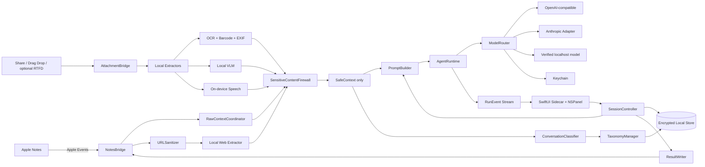

# Notes Sidecar：产品调研与技术方案

> 目标：让每篇 Apple Notes（备忘录）成为一段独立的 AI 对话；按需理解正文、图片与 EXIF、录音及链接网页，支持自动标签/分组、自定义模型 API、流式运行事件，并可复制或安全写回备忘录。
>
> **P0 产品不变量：任何尚未证明安全的内容都不得离开设备。隐私优先级高于功能完整度、识别效果和操作便利；用户名、密码及其他凭据绝不进入远程模型请求，这条规则没有关闭开关。**
>
> 本文是产品与技术方案，不包含功能实现。设计稿见同目录 `设计图总览.png`。

## 1. 先给结论

1. **个人隐私是 P0 基础原则，不是附加功能**。所有远程出口前必须经过不可绕过的本机隐私门；任何内容只要未完成检查、检查失败或结果不确定，就停留在本机。凭据保护不能由用户关闭，也不能用提示词替代。
2. **产品可做，但不应称为 Notes“插件”**。Apple 没有公开的 Notes 插件 SDK，也不适合向 Notes 进程注入代码。推荐产品形态是一个独立的 macOS companion app：菜单栏常驻 + 全局快捷键 + 依附 Notes 窗口右侧的浮动 `NSPanel`。
3. **最自然的价值不是“又一个聊天窗口”，而是“不迁移笔记也能持续对话”**。每篇笔记对应一段本地会话，当前笔记正文始终是最新上下文；用户可继续追问，但不会把整份正文反复复制进聊天历史。
4. **首版应以 AppleScript / Apple Events 为主路径**：当前 Notes 脚本字典能取得所选笔记的 ID、标题、HTML `body`、只读纯文本与修改日期，并支持创建或改写笔记。Accessibility 只作为精确光标写回、选区操作和窗口跟随的可选增强；Services/Share 是商店友好的降级路径。
5. **首版不要承诺展示“思维链”**。产品应展示可验证事件：读取了哪篇笔记、构建了什么上下文、调用了哪个模型/工具、耗时、token、错误与重试。模型内部推理既通常拿不到，也不应伪造。
6. **发行建议先走 Developer ID 签名并公证的官网 DMG**。Mac App Store 强制沙盒，而 Notes 面向第三方公开的脚本访问组非常有限；完整 Apple Events 控制和可选 UI 自动化更适合直装版。验证价值后，可另做能力收敛的 Service/Share 商店版。
7. **P0 多模态采用“原始内容不出设备，本机提取后只发送安全文字”**。图片由本地 OCR、二维码/条码、EXIF、Vision 分类和可选本地视觉模型理解；录音固定在 on-device Speech 转写并保留时间戳；网页固定由 App 以无 Cookie 会话抓取。三类结果统一经过凭据扫描，只把 `SafeContext` 文本交给远程模型。P0 禁止远程 Vision 原图输入和 Provider Web Fetch，因为任何本机预检都无法证明原图或远端网页绝对不含漏检凭据。
8. **Notes AppleScript 可枚举附件元数据，但不直接提供图片或录音二进制**。当前脚本字典公开 attachment 的 name、id、content identifier、日期和 URL；图片/录音需通过显式拖放/分享导入，或用户开启 Accessibility 后采用可回退的 RTFD/剪贴板提取，禁止读取 Notes 私有数据库。
9. **自动标签与分组保留为后续会话层能力，不默认改写 Notes**。当前版本不生成标签或分组，也不写回 Notes；未来启用时必须允许用户锁定、修改、合并或关闭自动整理。

## 2. 产品调研

### 2.1 用户问题

Apple Notes 的优势是系统级入口、同步快、无学习成本；弱点是内容一旦写入，后续通常只能靠搜索与人工整理。用户真实需要的是：

- 对当前笔记直接提问，不复制到其他 AI 产品；
- 从散乱内容中提炼任务、结论、结构与下一步；
- 每篇笔记保留自己的对话上下文，切回笔记即可续聊；
- 模型与 API 由用户控制，敏感笔记不经过开发者中转服务器；
- AI 输出可复制，也可在用户确认后插回 Notes；
- 笔记里的图片文字、画面主题、拍摄信息、录音内容和网页链接不再成为上下文盲区；
- 笔记可能包含用户名、密码、API Key、Token、验证码或私钥，任何远程模型调用都必须在发送前硬阻断这些内容；
- 会话数量增加后，需要自动标签、主分组、筛选和标签归一化，避免靠标题手工管理。

### 2.2 目标用户

| 用户 | 高频场景 | 愿意付费的价值 |
|---|---|---|
| 重度 Notes 用户 | 日常想法、会议记录、资料摘抄 | 不迁移数据，立即获得整理与问答 |
| 产品/研究人员 | 需求、访谈、竞品资料 | 每篇笔记独立上下文；快速提炼行动项 |
| 写作者/创作者 | 灵感、提纲、草稿 | 续写、重构、批判、标题与不同语气 |
| 隐私敏感用户 | 私人日记、内部材料 | 自定义供应商、本地模型、密钥仅存钥匙串 |

### 2.3 核心差异化

| 方案 | 优势 | 缺口 | Notes Sidecar 的机会 |
|---|---|---|---|
| Apple Writing Tools / Apple Intelligence | 系统级、体验原生、可改写与总结 | 不等于每篇笔记一段持久会话；模型选择有限 | 持久 per-note 会话、自定义 API、过程透明 |
| ChatGPT / 通用桌面助手 | 模型能力强、生态成熟 | 用户需要在另一应用管理会话；上下文归属不稳定 | 对话天然绑定当前笔记，不迁移内容 |
| Raycast AI 等启动器 | 快捷、适合选中文本动作 | 侧重一次性命令，不是笔记内长期会话 | 连续追问、笔记更新感知、写回流程 |
| Notion AI / Obsidian AI 插件 | 文档上下文和扩展生态更完整 | 需要迁移到另一套笔记系统 | 保留 Apple Notes 作为唯一内容源 |

### 2.4 产品定位

> **Notes Sidecar 是 Apple Notes 的本地优先 AI 边栏。它只在用户唤起时读取当前笔记，让每篇备忘录拥有一段独立、可继续的模型对话。**

它不是：

- 向 Notes 进程注入的插件；
- 自动读取整个 Notes 数据库的抓取器；
- 默认上传所有笔记的云服务；
- 展示模型私密思维链的“监控器”；
- 首版即拥有浏览器、终端、文件系统工具的全能 Agent。

## 3. 产品方案

### 3.1 MVP 用户链路

1. 用户在 Notes 打开并选中一篇笔记。
2. 按全局快捷键或点击菜单栏入口；可选的窗口边缘触点只负责唤起。
3. 首次运行请求“自动化 → Notes”权限；Sidecar 用 AppleScript 取得所选 `note.id`、标题、纯文本、HTML body 与修改日期。
4. 顶部显示上下文确认条：`已读取「重点 idea」· 374 字`。
5. 用户提问；回答流式出现。
6. 运行区显示可验证步骤：读取笔记 → 构建上下文 → 调用模型 → 整理结果。
7. 用户选择：复制、追加“AI 回答”区块或新建备忘录。精确插入光标/替换选区仅在用户开启 Accessibility 增强模式后提供。
8. 用户切换 Notes 选中项时，Sidecar 按 `note.id` 切换对应会话；若修改日期或正文 hash 变化，显示“笔记已更新”并刷新上下文。

### 3.2 MVP 功能边界

**必须有**

- 通过 AppleScript 读取当前所选笔记并枚举 attachment 元数据；
- 每篇笔记独立会话；
- 图片原文件不离开设备：本机执行 OCR、二维码/条码、EXIF 与 Vision 分类，可选本地视觉模型生成更完整描述；没有可用本地视觉模型时提供 OCR、元数据与基础分类，不降级上传远程 Vision；
- 录音文件固定在本机转写；只把通过隐私检查的文字提交给模型，不上传原始音频；不支持本地识别的语言或设备默认阻断；
- 链接先在本机清理 URL 并判断公开性，再以无 Cookie、无登录态的 ephemeral 会话抓取正文；Provider Web Fetch 在 P0 禁用，远程模型只接收扫描后的网页文字；
- 图片/录音附件支持拖放、Share/Service 显式导入，并探测可选 Accessibility/RTFD 提取能力；
- 所有文本、OCR、二维码/条码结果、本地视觉描述、转写、EXIF、URL 和本地抓取的网页正文统一经过 `SensitiveContentFirewall`；远程接口只能接收 `SafeContext` 文本；
- 检出用户名+密码、API Key、Token、Cookie、私钥、验证码、恢复码或连接串后，**只剔除命中的具体行或时间戳片段**；同一来源中未命中的安全内容仍可进入 `SafeContext`。扫描失败、规则未加载或无法确定结果时，整个请求 fail-closed，不允许远程发送；
- 每个会话自动生成一个主分组和 1–4 个标签，支持锁定、修改、合并、筛选和关闭自动整理；
- 流式回答、停止、重试及可审计运行事件；
- 复制、AppleScript 追加区块、新建备忘录；
- 开启 Accessibility 增强模式后提供选区读取、插入光标与替换选区；
- OpenAI-compatible 自定义 endpoint/model/key；
- 至少一个原生适配器（如 Anthropic）和一个本地模型入口（Ollama）；
- Keychain 密钥保存、本地历史记录、单篇/全部清空；
- 权限、隐私、防泄漏与受保护内容首启引导。

**首版不做**

- 跨全部 Notes 的向量检索/RAG；
- 自动后台读取、索引或批量转写整个 Notes 库；
- 登录网站、携带浏览器 Cookie、绕过付费墙或执行网页 JavaScript；
- 将录音自动发送给云端转写服务；
- 读取 Notes 私有数据库或附件存储目录；
- 浏览器自动操作、Shell、文件系统写入等高风险 Agent 工具；
- 团队同步、账号系统、开发者云端中转；
- 自动写回，所有写操作必须由用户确认；
- “完整思维链”展示。

### 3.3 过程展示定义

界面中的“过程”只包含审计事件，不包含隐藏推理：

```text
读取当前备忘录       374 字 · 18 ms
构建上下文           笔记 + 3 轮对话 · 9 ms
调用 MiniMax-M3      首字 0.8 s · 862 tokens
整理结果             4 个章节 · 21 ms
```

如未来加入工具，可展示：工具名、经脱敏的参数摘要、执行状态、耗时、结果摘要。API Key、完整请求头、Cookie、未脱敏 URL 和笔记全文不得进入运行日志。

### 3.4 会话与笔记绑定

不要把标题直接当唯一标识。当前 Notes 脚本字典可返回稳定的 `note.id`，因此首选直接保存：

```text
NoteLocator
- noteId（主键）
- accountName / folderName（用于排错和展示，不参与主键）
- titleSnapshot
- modificationDate
- bodyHash
```

每次发送请求前重新读取所选笔记，先核对 `note.id`，再比较修改日期与正文 hash。正文改变时不自动创建一条聊天消息，而是在 Prompt Builder 中替换“当前笔记快照”，同时记录一次 `context_updated` 事件。没有官方的 Notes 变更订阅 API，因此只在 Sidecar 展开或 Notes 位于前台时低频检查 selection/修改日期，不进行后台全库轮询。

写回前再次比对修改日期；如用户在生成期间改过笔记，必须显示冲突预览，不得静默覆盖。若 AppleScript 在特定系统版本无法返回 selection，则降级为用户从列表选择笔记，或采用 Service/Share 显式传入内容。

### 3.5 多模态上下文

每次请求构建统一的 `ContextManifest`：

```text
ContextManifest
- noteTextSnapshot
- imageArtifacts[]: OCR、二维码/条码、EXIF、本地视觉描述、安全状态、来源 attachmentId
- audioArtifacts[]: 本机转写、时间戳、语言、安全状态
- webArtifacts[]: SanitizedURL、本机提取正文/摘要、时间、安全状态
- excludedArtifacts[]: 排除原因，不含原始秘密值
```

处理原则：

1. AppleScript 先枚举 attachment 的 name、id、content identifier、日期和 URL。
2. 普通正文与 URL attachment 中的 `http/https` 链接先进入 `URLSanitizer`：删除 userInfo、fragment 和 token 型参数，阻止 localhost、私网、链路本地及云元数据地址；通过检查后也只允许本机抓取，不把 URL 交给 Provider Web Fetch。
3. 图片/录音二进制优先由用户拖入 Sidecar、通过 Share/Service 传入；可选增强模式才尝试从 Notes 选区的 RTFD/剪贴板提取，并立即恢复用户原剪贴板。
4. 图片原文件只进入本地处理链：Vision OCR、二维码/条码、`VNClassifyImageRequest` 基础分类、Image I/O EXIF，以及可选本地视觉模型。输出文字描述与来源定位后进入隐私扫描；没有本地视觉模型时明确标注“基础识别”，绝不上传远程 Vision。
5. 录音使用 `SFSpeechURLRecognitionRequest` 且强制 `requiresOnDeviceRecognition = true`；设备/语言不支持时可选本地 Whisper/Core ML，仍不可自动切换到云端。只有本机转写文本可进入后续模型请求，原始音频永不发送。
6. 网页统一由 `URLSessionConfiguration.ephemeral` 本机抓取，禁用 Cookie、credential storage、持久缓存和页面 JavaScript；每次 DNS 解析及跳转后重新校验目标 IP。正文提取后进入隐私扫描，只有安全文字可进入 `SafeContext`。登录页、私有地址和动态受限内容明确标为不可读取。

### 3.6 凭据与个人隐私硬隔离

隐私保护不能只靠 Prompt。实现一条模型路由之前的强制出口：

```text
Raw Note / Image / Audio / URL
→ Local Extractors（Image + Local VLM / Audio / Web）
→ SensitiveContentFirewall
→ PrivacyDecision
→ SafeContext（仅安全文字）
→ PromptBuilder / ConversationClassifier
→ Remote Model（只接收 SafeContext）
```

- 扫描范围包括 Notes 正文、用户问题、历史消息、OCR、音频转写、EXIF、URL、网页正文和自定义 headers；
- 检测器组合：确定格式规则（私钥、Token、Cookie、连接串、OTP、恢复码）、关键词邻近规则（用户名/账号/邮箱 + 密码/口令/PIN）和本地敏感实体识别；
- **Fail closed**：扫描超时、崩溃、规则未加载或结果不确定时，不允许发起远程请求；
- 检出任一凭据时排除命中的具体行或时间戳片段，不能以星号替换后继续外发；用户也不能点击“仍然发送原文”绕过。其余安全行可在预览确认后进入上下文；
- EXIF GPS、精确拍摄地点、设备序列号、人脸身份等默认为 Sensitive；GPS 不进入远程模型，即使用户开启普通 EXIF 分析；
- Protected 内容可由本地模型处理，但模型 endpoint 必须经回环地址验证；
- UI 只展示 `已排除 2 个凭据区块` 等统计，不显示被隐藏值；运行日志和崩溃报告不记录命中片段。

### 3.7 自动标签与分组

- 首次会话完成后生成 1 个主分组和 1–4 个标签；建议分组包括工作、个人、项目、学习、资料、健康、财务和私密；
- 检出凭据的会话由本地规则直接归入 `私密`，不调用远程分类；
- 其余会话优先使用本地规则/本地模型；如用户允许远程分类，只发送 `SafeContext` 的短摘要和现有标签表；
- `TaxonomyManager` 负责同义标签合并、大小写/语言归一、最大标签数和孤立标签清理，避免自动产生几十个近义词；
- 标签可锁定，锁定后自动分类不得删除或重命名；用户修改视为高优先级反馈；
- 默认仅写入 Sidecar 本地数据库。同步为 Notes `#tag` 或移动文件夹属于单独 opt-in 写操作，必须预览确认。

## 4. 平台技术边界

### 4.1 推荐的 NotesBridge 多策略架构

| 策略 | 能力 | 优点 | 风险/限制 | MVP 地位 |
|---|---|---|---|---|
| AppleScript / Apple Events | 取得所选笔记 ID、标题、HTML body、纯文本、修改日期；枚举 attachment 的 name/id/content identifier/日期/URL；创建或改写笔记 | 对象级、可按 note ID 绑定会话，不依赖像素与界面语言 | 不提供普通图片/录音的二进制读取；首次触发 Automation 授权；覆盖 HTML 可能损坏复杂格式 | **主路径** |
| Accessibility / AXUIElement | 读取选区、定位窗口、模拟聚焦与光标写回 | 可实现精确插入和自动跟随窗口 | 需辅助功能权限；依赖 UI 结构与焦点，系统更新易失效 | 可选增强 |
| Shortcuts | Find/Create/Append Notes，可作为 Quick Action | 用户可见、系统原生 | 没有可靠的“当前 Notes 笔记”对象，持续会话体验弱 | 集成补充 |
| Services / Share Extension | 用户主动传入选中文字、文本、URL、图片或音频文件 | 权限清晰、适合可靠导入附件、Mac App Store 友好 | 多一步操作；扩展短生命周期；拿不到当前 note ID，也不能持续监听 | 附件可靠入口 / 商店版降级 |
| Clipboard fallback | 复制选区后读取 | 容易实现 | 污染剪贴板，需恢复原内容并明确提示 | 最后降级 |
| 直接读 Notes 数据库 | 可获得大量内容 | 表面上最“完整” | 私有实现、数据库/CloudKit 结构不稳定、隐私与审核风险高 | **禁止** |

**已核实的附件边界**：Notes 的本机 scripting dictionary 存在 `attachment` class，但仅公开 `name`、`id`、`container`、`content identifier`、creation/modification date、URL 和 shared。没有公开读取附件字节或 `save attachment` 的命令。因此“自动识别图片/录音”必须以 Phase 0 真实验证为前提，并提供显式导入的可靠路径，不能把 `content identifier` 当作可直接访问的文件路径。

### 4.2 窗口形态

- AppKit `NSPanel` 作为伴随窗口，SwiftUI 提供内容视图；
- MVP 默认在鼠标所在屏幕右侧或上次位置出现，不依赖 Accessibility；
- 用户开启“跟随 Notes 窗口”后，再通过 AX 观察 Notes 主窗口激活、移动与缩放；
- 跟随模式与 Notes 窗口保持 12–16pt 间距，不覆盖编辑区；
- 支持吸附右侧、左侧、独立浮窗三种模式；
- 全屏 Notes 使用 `.fullScreenAuxiliary`，但必须允许用户关闭跟随；
- 菜单栏图标和快捷键是可靠入口，边缘悬浮触点只是增强体验。

## 5. 技术架构

### 5.1 技术选型

- **语言/UI**：Swift 6、SwiftUI + AppKit；
- **窗口**：`NSPanel` / `NSWindowController`；
- **Notes 接入**：Apple Events / AppleScript 主路径；ApplicationServices Accessibility API 为可选增强；Shortcuts/Services/Share 为附件可靠入口与降级集成；
- **图片本机理解**：Vision `VNRecognizeTextRequest`、`VNDetectBarcodesRequest`、`VNClassifyImageRequest`；Image I/O `CGImageSourceCopyPropertiesAtIndex` 读取 EXIF/GPS；可插拔本地 VLM（Core ML/MLX）增强视觉描述；原图不外发；
- **录音本机转写**：AVFoundation 解码，Speech `SFSpeechURLRecognitionRequest` 强制 on-device；可选本地 Whisper/Core ML 降级；原始音频不外发；
- **网页本机读取**：`URLSanitizer` + ephemeral `URLSession` + HTML 正文提取，禁 Cookie、缓存、凭据与登录态；P0 不调用 Provider Web Fetch；
- **隐私与分类**：`SensitiveContentFirewall` actor、凭据规则引擎、本地实体识别、`TaxonomyManager`；
- **网络**：`URLSession`，SSE/增量 JSON 流解析；
- **并发**：Swift Concurrency，Provider/Session/Run 各自 actor 隔离；
- **存储**：SwiftData 或 SQLite；
- **密钥**：Keychain Services；
- **可选本地加密**：CryptoKit AES-GCM，数据密钥存 Keychain；
- **日志**：OSLog，所有模型凭据与笔记正文默认脱敏；
- **最低系统**：建议 macOS 15+；macOS 26 使用原生 Liquid Glass，旧系统回退 `NSVisualEffectView`。

### 5.2 模块图



### 5.3 核心协议

```swift
protocol NotesContextProviding {
    func currentContext() async throws -> NoteContext
    func observeContextChanges() -> AsyncStream<NoteContextChange>
}

protocol NotesAttachmentProviding {
    func enumerateAttachments(in note: NoteLocator) async throws -> [AttachmentLocator]
    func importArtifact(_ source: AttachmentImportSource) async throws -> LocalArtifact
}

protocol LocalImageUnderstanding {
    func analyze(_ image: LocalImageRef) async throws -> LocalImageAnalysis
}

protocol WebContentProviding {
    func extractLocally(_ url: SanitizedURL) async throws -> WebArtifact
}

protocol SensitiveContentFiltering {
    func evaluate(_ raw: RawContextBundle) async -> PrivacyDecision
}

protocol ConversationClassifying {
    func classify(_ context: SafeContext, taxonomy: Taxonomy) async throws -> TaxonomyProposal
}

protocol NotesWriting {
    func insert(_ content: AttributedString, target: WriteTarget) async throws
}

protocol ModelProvider {
    var capabilities: ProviderCapabilities { get }
    func stream(_ context: SafeContext) -> AsyncThrowingStream<ModelEvent, Error>
}
```

不要让 UI 直接调用 Accessibility 或供应商 API。`NotesBridge` 与 `ModelProvider` 都必须可替换，才能抵抗 Notes UI 变化和模型协议差异。

### 5.4 数据模型

```text
ProviderProfile
- id, name, kind, baseURL, defaultModel
- keychainCredentialRef, customHeadersEncrypted
- capabilities, createdAt, updatedAt

NoteSession
- id, noteLocator, displayTitle, bodyHash
- providerProfileId, modelOverride
- createdAt, updatedAt, lastOpenedAt

Turn
- id, sessionId, role, content, status
- inputTokens, outputTokens, durationMs
- createdAt

RunEvent
- id, turnId, sequence, eventType
- label, status, redactedSummary, durationMs

AttachmentArtifact
- id, sessionId, noteAttachmentId, kind, localBookmarkRef
- sha256, extractionStatus, createdAt, expiresAt

LocalAnalysisArtifact
- id, artifactId, ocrText, barcodeKinds, transcriptSegments
- localVisualDescription, exifFieldKinds, extractedWebTextRef
- safetyStatus, evaluatedAt

PrivacyDecision
- id, requestId, status: safe/protected/blocked/failedClosed
- excludedSourceIds, findingKinds, policyVersion, evaluatedAt
- 不保存命中的秘密原文

ConversationGroup
- id, name, source: system/user, isLocked, sortOrder

ConversationTag
- id, normalizedName, displayName, source, isLocked

SessionTaxonomy
- sessionId, primaryGroupId, tagIds, confidence, classifiedAt, safeContextHash
```

### 5.5 模型 API 设计

首版适配层分三类：

1. **OpenAI-compatible**：配置 `baseURL`、model、API Key、可选 headers；支持 chat/completions 或 responses 风格中的一个明确文本子集。
2. **原生供应商**：为流式文本事件和 token usage 做严格解析，不假设完全 OpenAI 兼容。
3. **本地 Ollama / 本地 VLM**：仅允许 `localhost/127.0.0.1/::1` 明文 HTTP；其他自定义 endpoint 默认要求 HTTPS，且一律按远程服务处理。

`ProviderCapabilities` 的 P0 远程部分只需记录 `streaming`、`tools`、`jsonOutput`；`visionInput` 和 `webFetchTool` 对远程 Provider 固定关闭。本地 VLM 作为独立 `LocalImageUnderstanding` 能力，不与远程 Provider 混用。

安全规则：

- Provider API 在类型层面只接收 `SafeContext` 文本，不能传入原始 Notes、图片、音频、URL 或附件引用；
- API Key 只写 Keychain，不写 SwiftData、日志、崩溃报告或导出文件；
- “测试连接”只返回模型列表/最小请求结果，错误信息先脱敏；
- 自定义 headers 中疑似凭据字段进入 Keychain；
- 禁止把 Key 当作 profile ID、字典 key、会话标题或通知文本；
- 网络请求默认从本机直连供应商，不经过开发者服务器；
- 未来如增加代理服务器，必须单独征得用户同意并解释数据流。

### 5.6 多模态本机提取

**图片：本地 AI 理解，原图永不出站**

- `ImageExtractor` 读取用户授权的本地副本，不长期保存原图；默认在本次会话结束或 24 小时内删除缓存；
- Vision OCR 使用 accurate 模式记录文字区域；`VNDetectBarcodesRequest` 检查二维码/条码；Image I/O 读取尺寸、方向及全部 EXIF；
- `LocalImageUnderstanding` 默认使用 `VNClassifyImageRequest` 做基础场景/对象分类；可选经验证的 Core ML/MLX 本地 VLM 增强图表和复杂场景描述；运行界面明确标注“本机 AI”；
- OCR、二维码、EXIF 和本地视觉描述一起进入隐私防火墙，只有扫描后的文字摘要进入 `SafeContext`；
- 可选本地 VLM 不可用、内存不足或失败时，保留 OCR、元数据与 Vision 基础分类，不把原图降级上传到远程 Vision。

**录音：本机转写后仅发送安全文字**

- `AudioExtractor` 用 AVFoundation 标准化采样率和声道，按时长分片；
- `SFSpeechRecognizer.supportsOnDeviceRecognition` 为 true 才启用系统转写，并设置 `requiresOnDeviceRecognition = true`；
- 无本机语言包、识别失败或本机资源不足时，状态为 `local_transcription_unavailable`，不自动上传；
- 可选本地 Whisper/Core ML 作为离线降级；首版不承诺说话人分离，保留时间戳用于回听；
- 原始录音不进入远程模型。只有通过隐私防火墙的转写文本进入 `SafeContext`。

**链接：本机抓取，AI 只理解安全正文**

- `URLSanitizer` 只接受 `http/https`，默认要求 HTTPS；移除 userInfo、fragment 和 token 型参数，阻止 localhost、回环、私网、链路本地及云元数据地址；
- App 使用 `URLSessionConfiguration.ephemeral` 本机抓取，禁用 Cookie、credential storage、持久缓存与页面 JavaScript；每次 DNS 解析及跳转后重新校验目标 IP，并限制大小、MIME 与总耗时；
- 本地抓取正文必须经过 `SensitiveContentFirewall` 后才能进入 `SafeContext`；远程模型通过安全正文理解网页，不调用 Provider Web Fetch；
- 抓不到正文时让用户显式分享或复制；登录页、付费墙和动态受限内容明确标为不可读取。

### 5.7 SensitiveContentFirewall

`SensitiveContentFirewall` 是单一强制出口，不是可选设置：

```swift
actor SensitiveContentFirewall {
    func makeSafeContext(from raw: RawContextBundle) async -> PrivacyDecision
}
```

规则：

1. `ModelRouter` 和 `ConversationClassifier` 的公共 API 只接受 `SafeContext`。类型层面禁止远程模块接收 `RawContextBundle`、原始附件、图片、音频、URL 或本地文件引用。
2. 确定性高风险类型包括密码字段、Private Key、API Key、Bearer Token、Cookie/Session、OTP、恢复码、信用卡安全码、数据库/云连接串、URL userInfo。
3. 账号/用户名/邮箱本身按个人信息留在本机扫描；一旦同一来源内出现密码/PIN/验证码或其他凭据证据，整个来源升级为 Protected，连同其中的账号标识一起排除。独立用户名是否进入远程上下文由个人信息策略决定，默认也做掩码。
4. 任何扫描错误都生成 `privacy_scan_failed`，请求停在本机；UI 只允许改用已验证的本地模型、删除相关来源或取消。
5. 远程请求前生成 `EgressManifest`：provider ID、目标域名、安全上下文 hash、包含/排除的来源种类、策略版本；不包含正文。
6. 单元测试必须拦截 URLSession body 并断言秘密值不存在；集成测试使用 canary secrets，任何泄漏立即使构建失败。

### 5.8 自动标签与分组引擎

```text
SafeContext + existing taxonomy + user overrides
→ Local Heuristics
→ optional Local Classifier
→ optional Remote Classifier（仅 SafeContext summary）
→ TaxonomyManager
→ TaxonomyProposal
→ user-visible update
```

- 首次回答完成后分类；之后仅在上下文 hash 明显变化或累计新增内容达到阈值时重新分类，不随每个 token 更新；
- `TaxonomyManager` 将候选标签映射到规范词表，做同义词合并、语言归一、数量上限和弃用迁移；
- 每个会话最多 1 个主分组、4 个自动标签；用户标签不受自动上限影响；
- 用户锁定的分组/标签不可被自动分类覆盖；自动变更提供一次撤销；
- Protected 会话的分组和标签只能在本机生成；若本机分类能力不可用，则仅加 `私密` 系统标签，不做语义推断；
- 自动分类结果是导航元数据，不得用于绕过隐私策略或决定是否发送原文。

## 6. Liquid Glass 设计落地

Apple 的指导是让 Liquid Glass 服务于导航和控制，内容保持主导；不要玻璃叠玻璃。对应到本产品：

- 玻璃用于：Sidecar 外壳、标题栏、输入框、模型选择、状态胶囊、底部动作栏；
- 不用于：长回答正文、运行日志正文、设置表单的大面积内容背景；
- macOS 26：优先系统组件；自定义控件用 `glassEffect(_:in:)`，相邻控件放入 `GlassEffectContainer`；
- 默认用 Regular glass，只有媒体背景才考虑 Clear；
- 旧系统：`NSVisualEffectView` + `.behindWindow`，必须提供不透明度增强选项；
- 支持 Reduce Transparency、Increase Contrast、Reduce Motion；
- 面板展开/收起采用一次材料形变，不给每个卡片添加通用浮入动画。

设计稿采用“流光边栏（Luminous Margin）”：琥珀表示 Notes 上下文，薄荷表示 AI 工作状态，浅紫表示模型/能力；正文保持深蓝灰稳定阅读面。

## 7. 权限与隐私

### 7.1 权限说明

| 权限 | 用途 | 是否必需 | 设计要求 |
|---|---|---|---|
| Automation / Apple Events | 取得所选笔记、读取/创建/追加 Notes 对象 | 直装 MVP 必需 | 首次调用时申请；用途说明只写“控制 Notes” |
| Accessibility | 精确选区、光标写回、跟随 Notes 窗口 | 否，增强模式才需要 | 用到时再申请；拒绝后仍可复制/AppleScript 追加 |
| Network | 连接用户选择的模型 API；按需抓取公开网页 | 模型/网页功能必需 | 分别显示模型域名和网页域名；网页抓取不带 Cookie/登录态 |
| Speech Recognition | 转写现有录音文件 | 音频识别时按需 | 先解释仅做本机识别；Info.plist 提供用途说明；拒绝后不上传云端 |
| Microphone | 不需要 | 否 | MVP 只处理已有录音，不做现场录音 |
| Screen Recording | 不需要 | 否 | AppleScript/AX 不读取屏幕像素；不要为此索取权限 |

### 7.2 隐私默认值

- 不建立开发者云端账号；
- 不后台索引全库，不自动遍历全部附件或链接；
- 仅在用户打开 Sidecar 或主动快捷操作时读取当前笔记；
- 远程模型只能接收通过隐私防火墙的 `SafeContext` 文字；原始 Notes、图片、录音、URL 和本地文件引用永不进入远程请求；
- 密码、Token、私钥、Cookie、验证码、恢复码、连接串的命中行或时间戳片段绝不发送到远程模型；同一来源内的安全内容可保留，规则不可由用户关闭；扫描失败则整个请求阻断；
- 图片 OCR、EXIF 和语义理解均在本机完成；GPS、设备序列号及精确地点仅本机可见；
- 网页固定在本机抓取，不使用 Provider Web Fetch、Safari Cookie、浏览历史、Authorization 或持久缓存；
- Protected 会话的自动标签/分组仅在本机生成；
- 本地保存对话历史，可选择“退出即清空”；原始附件缓存有独立 TTL；
- 写回前提供 diff/预览；
- 诊断包默认不包含笔记正文、Prompt、回答、附件、转写、网页正文或凭据；
- 运行日志仅保留事件元数据、隐私 finding 类型和脱敏摘要。

## 8. 分阶段开发计划

### Phase 0：技术与隐私探针（5–7 天）

- 验证 3 个 macOS/Notes 版本下 AppleScript `selection`、`note.id`、纯文本、HTML body、修改日期和 attachment 元数据；
- 用真实图片、扫描件、录音、URL attachment 验证 Notes 选区复制后的 pasteboard/RTFD 类型，确认哪些附件可可靠提取；
- 验证拖放、Share/Service 显式导入图片和录音的可靠路径；
- 验证 Vision OCR、二维码/条码、EXIF、本地 VLM、on-device Speech 语言支持和网页 ephemeral 抓取；
- 建立凭据 canary 数据集，验证正文、OCR、二维码、本地视觉描述、转写、EXIF、URL、本地网页正文及用户输入全部经过 Fail-closed 防火墙；
- 单独探测 AX 选区、正文光标和窗口 frame，确定是否值得纳入增强模式；
- 输出 Notes/附件/语言兼容矩阵，不做正式 UI。

**退出条件**：

1. AppleScript 主路径能完成“识别当前笔记 → 读取 → 按 ID 续聊 → 用户确认后追加”；
2. 图片和录音至少各有一条无需私有数据库的可靠导入路径；
3. 网络拦截测试证明模型请求只包含 `SafeContext` 文本，图片、音频、URL 和本地文件引用均不存在；
4. 测试代理端收到的文字中不存在任何 canary secret；
5. 任一隐私扫描失败都会在网络层之前终止请求。

附件自动提取若不稳定，MVP 必须明确采用“检测到附件 → 用户点选导入/拖放”的半自动路径，不能伪装成无感全自动。

### Phase 1：隐私安全 MVP（3–4 周）

- 菜单栏 + 快捷键 + NSPanel；
- 当前笔记正文和 attachment manifest；
- 图片 OCR/二维码/EXIF 与本地 VLM 描述；录音本机转写；网页本机提取；
- `SensitiveContentFirewall`、`SafeContext`、`EgressManifest` 和 canary 防泄漏测试；
- OpenAI-compatible 文本流式回答与经验证的本地视觉/语音能力；
- per-note 本地会话；
- 自动主分组、1–4 个标签、用户锁定/修改/撤销；
- 复制/追加/新建、Keychain、权限引导、错误恢复、停止与重试。

### Phase 2：公开测试（2–3 周）

- Anthropic/Ollama 适配、本地 VLM/语音模型能力矩阵与回归测试；
- 显式附件导入体验、RTFD/AX 增强兼容矩阵；
- 标签归一化、合并、筛选和 Protected 本地分类；
- 模型 profile、每篇笔记覆盖、上下文变化检测；
- Liquid Glass、VoiceOver、可访问性和隐私状态完善；
- 网络 SSRF/重定向、Speech 语言、Notes 版本回归；
- 自动更新、签名、公证、隐私说明。

### Phase 3：高级能力（验证需求后）

- 用户可见、可审批的工具调用；
- 跨笔记搜索（明确 opt-in，仍经过同一隐私防火墙）；
- 本地视觉模型增强、说话人分离、手写识别质量提升；
- 用户明确 opt-in 后同步 Sidecar 标签到 Notes；
- 引用来源、模板化工作流和导出对话/运行记录。

## 9. 主要风险与缓解

| 风险 | 影响 | 缓解 |
|---|---|---|
| Notes AppleScript 字典或 selection 行为变化 | 无法识别当前笔记 | 版本探针、显式笔记选择、Service/Share 降级 |
| Notes 只暴露附件元数据、不暴露二进制 | 图片/录音无法无感提取 | 拖放/Share/Service 作为可靠入口；RTFD/AX 仅作经验证增强；禁止私库读取 |
| 可选 AX 增强随 UI 变化失效 | 无法精确插入或跟随窗口 | 不影响核心问答；自动关闭增强并退回复制/AppleScript 追加 |
| Apple Events/App Store 限制 | 审核失败或功能受限 | 官网 Developer ID 公证版优先；商店版采用 Service/Share 收敛能力 |
| 复杂 HTML、共享/锁定笔记 | 解析或写回破坏格式 | 读取与写回分离；默认只读；仅追加且写前检查修改日期 |
| 本地 VLM 不可用或性能不足 | 图片只能做 OCR、元数据和基础分类 | 明确降级，不上传远程 Vision；提供可选本地模型包与设备能力检测 |
| 本地图片识别错误 | 产生错误事实 | 保留来源与置信度，回答标注“本机图像分析”，允许查看原图和纠正 |
| 录音语言不支持本机识别 | 无法转写 | 本地 Whisper/Core ML 可选；否则明确阻断，不自动上传云端 |
| 本机网页抓取造成 SSRF 或泄露登录态 | 访问内网或暴露 Cookie | 禁 Cookie/凭据、DNS/redirect IP 校验、大小/时限限制；P0 禁 Provider Web Fetch |
| 凭据扫描漏检 | 用户秘密进入远程模型 | 多层确定规则+本地实体检测、整来源排除、Fail closed、canary egress 测试 |
| 自动标签膨胀或误分组 | 导航混乱 | 规范词表、同义合并、数量上限、用户锁定与一键撤销 |
| 自定义 API 泄漏隐私 | 高风险 | Provider 只接受 SafeContext 文本、直连、Keychain、EgressManifest、域名确认、HTTPS 默认 |
| 回答误写覆盖原文 | 数据损失 | 默认复制；写回必预览；优先追加；支持撤销说明 |
| “过程”被误解为思维链 | 信任风险 | 明确标注运行事件；不生成伪推理内容 |

## 10. 验收标准

- 打开任意 Notes 笔记，2 秒内唤起并吸附 Sidecar；
- 上下文标题、字数、正文与当前笔记一致，并列出附件与链接处理状态；
- 切换笔记后不会串会话；
- 图片在本机完成 OCR、二维码、EXIF 和本地 AI 视觉理解；任何远程请求均不包含图片字节、图片 URL 或本地文件引用；
- 支持的录音语言可在本机完成转写；远程模型只收到安全文字，不支持时不产生任何云端音频或转写请求；
- 链接由本机无 Cookie 会话抓取并扫描；Provider 不接收原始 URL，不访问本机/私网/云元数据地址；
- 正文、用户输入、OCR、二维码、本地视觉描述、转写、EXIF、URL 和网页中的 canary 密码/Token/私钥均不会出现在测试模型服务收到的文字；
- 防火墙超时、崩溃或规则加载失败时，请求必须停在网络发送之前；
- 每个新会话在首轮完成后得到 1 个主分组和 1–4 个标签；用户锁定值不会被自动覆盖；
- API Key 不出现在日志、数据库、通知或崩溃报告；
- 流式回答可停止、重试；
- 复制结果准确；插入/替换前有明确预览；
- Notes 未运行、权限拒绝、网络失败、模型不兼容都有可执行的恢复指引；
- Reduce Transparency / Increase Contrast 下仍可读；
- 真实业务验证覆盖：读取 → 提问 → 流式回答 → 复制/插入 → 重新打开同笔记续聊。

## 11. 设计文件

- `设计理念-流光边栏.md`
- `设计图01-对话主界面.png`
- `设计图02-过程与结果.png`
- `设计图03-模型设置.png`
- `设计图04-权限与隐私.png`
- `设计图总览.png`

原有 `编组01.png`、`编组02.png`、`编组03.png` 未修改。

## 12. 参考资料

- Apple Human Interface Guidelines — Materials: https://developer.apple.com/design/human-interface-guidelines/materials
- Apple — Adopting Liquid Glass: https://developer.apple.com/documentation/TechnologyOverviews/adopting-liquid-glass
- Apple — `glassEffect(_:in:)`: https://developer.apple.com/documentation/swiftui/view/glasseffect%28_%3Ain%3A%29
- Apple WWDC25 — Meet Liquid Glass: https://developer.apple.com/videos/play/wwdc2025/219/
- Apple WWDC25 — Get to know the new design system: https://developer.apple.com/videos/play/wwdc2025/356/
- Apple — Designing for macOS: https://developer.apple.com/design/human-interface-guidelines/designing-for-macos/
- Apple — App Extensions: https://developer.apple.com/documentation/appkit/app-extensions
- Apple — How Mac Scripting Works / scripting dictionaries: https://developer.apple.com/library/archive/documentation/LanguagesUtilities/Conceptual/MacAutomationScriptingGuide/HowMacScriptingWorks.html
- Apple — UI scripting: https://developer.apple.com/library/archive/documentation/LanguagesUtilities/Conceptual/MacAutomationScriptingGuide/AutomatetheUserInterface.html
- Apple — Share Extension: https://developer.apple.com/library/archive/documentation/General/Conceptual/ExtensibilityPG/Share.html
- Apple — Services: https://developer.apple.com/library/archive/documentation/Cocoa/Conceptual/SysServices/Articles/using.html
- Apple Shortcuts — Append and share actions: https://support.apple.com/guide/shortcuts-mac/apdaf74d75a5/mac
- Apple — Apple Events entitlement: https://developer.apple.com/documentation/bundleresources/entitlements/com.apple.security.automation.apple-events
- Apple Developer Forums — Notes automation under Mac App Sandbox: https://developer.apple.com/forums/thread/840990
- Apple — Writing Tools: https://support.apple.com/guide/mac-help/writing-tools-write-improve-summarize-mchldcd6c260/mac
- Apple Vision — Recognizing text in images: https://developer.apple.com/documentation/vision/recognizing-text-in-images
- Apple Vision — Classifying images for categorization and search: https://developer.apple.com/documentation/vision/classifying-images-for-categorization-and-search
- Apple Image I/O — `CGImageSourceCopyPropertiesAtIndex`: https://developer.apple.com/documentation/imageio/cgimagesourcecopypropertiesatindex%28_%3A_%3A_%3A%29
- Apple Speech — `requiresOnDeviceRecognition`: https://developer.apple.com/documentation/speech/sfspeechrecognitionrequest/requiresondevicerecognition
- Apple Speech — `supportsOnDeviceRecognition`: https://developer.apple.com/documentation/speech/sfspeechrecognizer/supportsondevicerecognition
- Apple Speech — `SFSpeechURLRecognitionRequest`: https://developer.apple.com/documentation/speech/sfspeechurlrecognitionrequest
- Apple Foundation — ephemeral URLSession configuration: https://developer.apple.com/documentation/foundation/urlsessionconfiguration/ephemeral
- Apple Security — Preventing insecure network connections: https://developer.apple.com/documentation/security/preventing-insecure-network-connections
- Raycast AI: https://www.raycast.com/core-features/ai
- Obsidian community plugins: https://obsidian.md/help/community-plugins
- Notion Agent: https://www.notion.com/help/notion-agent
- Mem: https://mem.ai/
