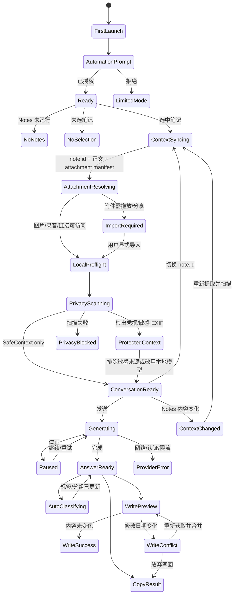

# Notes Sidecar：完整交互与产品规格

> 版本：MVP+ / macOS companion app / P0 隐私与多模态简化架构
>
> 目标：覆盖从首次安装到长期使用的完整交互状态。本文延续 `产品调研与技术方案.md` 的平台结论：AppleScript / Apple Events 是读取所选笔记和按 `note.id` 绑定会话的主路径；Accessibility 仅作为精确写回与窗口跟随的可选增强。
>
> **P0 产品不变量：任何尚未证明安全的内容都不得离开设备。隐私优先级高于识别效果、功能完整度和操作便利；这条规则固定开启，任何界面、Provider 或用户操作都不能绕过。**

## 1. 产品定义

### 1.1 一句话

**Notes Sidecar 是 Apple Notes 的本地优先 AI 边栏：每篇笔记对应一段独立对话，可理解正文、图片与 EXIF、录音和链接网页，自动整理标签/分组，并在任何远程模型调用前从本机硬隔离用户名、密码及其他凭据。**

### 1.2 首版必须成立的体验

1. 任何远程请求都必须先通过本机隐私门；未检查、检查失败或结果不确定时，网络请求数必须为 0。
2. 不离开 Notes，不复制正文，就能对当前笔记提问。
3. 切换笔记时，会话按 `note.id` 正确切换，绝不串线。
4. 用户始终知道 AI 读取了哪篇笔记、使用哪个模型、哪些内容将离开设备。
5. API Key 只进入 Keychain，请求从本机直达用户选择的模型服务。
6. 默认只读；所有写回操作都由用户触发，并在冲突时显示预览。
7. 不展示或虚构模型内部思维链，只展示可验证的运行事件。
8. 图片由本地 AI 完成 OCR/二维码/EXIF 与语义理解；录音固定本机转写；链接固定由 App 本机抓取。三类原始内容都不交给远程模型。
9. 用户名、密码、API Key、Token、Cookie、私钥、验证码、恢复码及命中这些凭据的整个来源项绝不发送给远程模型；没有关闭或绕过操作。
10. 每个会话自动生成一个主分组和 1–4 个标签；用户可锁定、修改、合并、撤销或关闭自动整理。

### 1.3 交互设计原则

- **内容优先**：Notes 是工作台，Sidecar 是临近工具层。
- **一篇笔记，一个会话**：不要求用户管理多余的聊天空间。
- **按需读取**：Sidecar 关闭时不轮询、不索引整个 Notes 库。
- **可回退**：Automation 被拒绝时仍可通过 Service/Share 或复制内容完成问答。
- **可逆写回**：复制优先、追加其次、精确替换最后；任何覆盖行为都必须明确。
- **状态真实**：运行过程以事件、耗时和工具结果表达，不伪造“思考”。
- **未证明安全，就不外发**：远程 Provider 只能访问 `SafeContext` 文字；原始 Notes、图片、录音、URL 和本地文件引用都不属于可发送类型。
- **来源可见**：回答能回到图片、录音时间戳或网页 URL；低置信度结果明确标注。
- **自动但可控**：标签和分组自动生成，但用户锁定与修改优先。
- **原生但不冒充原生**：视觉服从 macOS，但明确是独立伴侣窗口，不伪装成 Notes 内建按钮。

## 2. 信息架构

```text
菜单栏 Notes Sidecar
├─ 打开边栏
├─ 当前笔记快捷操作
├─ 最近会话
├─ 模型状态
├─ 设置
└─ 退出

Sidecar 主窗口
├─ Header
│  ├─ 当前笔记/同步状态
│  ├─ 主分组与标签
│  ├─ 附件/链接处理状态
│  ├─ 历史记录
│  ├─ 模型选择
│  └─ 更多菜单
├─ Conversation
│  ├─ 上下文与隐私事件
│  ├─ 多模态来源条
│  ├─ 用户消息
│  ├─ 运行事件
│  ├─ AI 回答与来源引用
│  └─ 回答操作
└─ Composer
   ├─ 作用范围：整篇/选区
   ├─ 快捷操作
   ├─ 输入区
   ├─ 附加指令
   └─ 发送/停止

设置中心
├─ Notes 连接
├─ 模型与服务商
├─ 通用
├─ 外观与窗口
├─ 多模态与网页
├─ 隐私防火墙
├─ 标签与分组
├─ 隐私与数据
├─ 快捷键
└─ 关于与更新
```

## 3. 核心状态机



## 4. 界面清单与设计图映射

| 编号 | 界面/状态 | 关键任务 | 设计图 |
|---|---|---|---|
| 01 | 主对话界面 | 基于当前笔记连续提问 | `设计图01-对话主界面.png` |
| 02 | 回答、运行记录、上下文 | 审计运行过程并处理结果 | `设计图02-过程与结果.png` |
| 03 | 模型连接 | 自定义 endpoint、model、Key | `设计图03-模型设置.png` |
| 04 | 权限与隐私 | 解释 Automation、可选 Accessibility、网络 | `设计图04-权限与隐私.png` |
| 05 | 首次启动、权限请求、成功 | 完成首次连接 | `设计图05-首次启动与自动化权限.png` |
| 06 | Notes 未运行、未选笔记、切换同步 | 处理上下文空状态 | `设计图06-空状态与笔记切换.png` |
| 07 | 输入、作用范围、快捷指令 | 高效发起请求 | `设计图07-输入与快捷操作.png` |
| 08 | 生成、停止、重试 | 控制长时间请求 | `设计图08-生成中与中断恢复.png` |
| 09 | 追加预览、精确替换、冲突 | 安全写回 Notes | `设计图09-写回预览与冲突.png` |
| 10 | 当前笔记历史、搜索、清空/导出 | 管理会话内容 | `设计图10-历史记录与会话管理.png` |
| 11 | 服务商、模型、每篇笔记覆盖 | 管理模型策略 | `设计图11-模型与服务商管理.png` |
| 12 | 通用、Notes 连接、隐私与数据 | 调整长期行为 | `设计图12-设置隐私与数据.png` |
| 13 | 认证、限流、读取、写回失败 | 恢复错误 | `设计图13-错误状态与恢复.png` |
| 14 | 吸附、独立、紧凑、浅色 | 适应不同窗口习惯 | `设计图14-窗口模式与浅色外观.png` |
| 15 | Command Palette、快捷键、降低透明度 | 键盘与无障碍使用 | `设计图15-键盘与无障碍.png` |

**新增能力对应的界面增补**：

- 01 主界面：增加来源条、Protected Banner、主分组与标签 Chip；
- 02 过程与结果：增加 OCR/EXIF/转写/网页/隐私扫描事件与来源引用；
- 06 空状态：增加“附件需要显式导入”和“本机转写不可用”；
- 07 输入：增加多模态上下文清单；
- 10 历史：增加按分组折叠和标签筛选；
- 11 模型：标明 Vision 能力与本地/远程处理位置；
- 12 设置：增加多模态、隐私防火墙、标签与分组；
- 13 错误：增加附件、网页、转写、隐私检查和分类恢复状态。

本轮先更新需求与开发方案；上述视觉增补应作为下一轮设计图修订范围，避免文档与旧图被误认为完全一致。

## 5. 端到端用户流程

### 5.1 首次连接

1. Welcome 只解释三件事：读取当前笔记、用户控制模型、默认不写回。
2. 用户点击“连接 Apple Notes”。
3. App 首次发送 Apple Event，系统弹出 Automation 权限对话框。
4. 授权后立即读取当前所选笔记，并显示标题/字数用于建立信任。
5. 进入模型设置；用户可选择预置服务商、自定义 OpenAI-compatible 或 Ollama。
6. 测试连接成功后进入主界面。

**拒绝 Automation**

- 不循环弹系统权限；
- 展示“打开系统设置”和“使用受限模式”；
- 受限模式允许用户通过 macOS Services/Share 或粘贴文本发起一次性对话；
- Header 始终显示“未连接 Notes”。

### 5.2 日常提问

1. 用户在 Notes 选中笔记，按 `⌥⌘N`。
2. Sidecar 读取 `note.id`、标题、plaintext、body hash、修改日期。
3. 若是首次见到该 note ID，创建空会话；否则恢复历史。
4. Context Chip 显示 `重点 idea · 374 字 · 刚刚同步`。
5. 用户输入问题，默认 `⌘↩` 发送；Return 保留换行，避免在写作场景误发送。
6. 回答流式出现；运行记录保持折叠。
7. 结果完成后显示 Copy、Append、New Note；Accessibility 增强开启后额外显示 Replace Selection / Insert at Cursor。

### 5.3 切换笔记

- Sidecar 展开且 Notes 位于前台时，低频检查 selection；
- 发现 `note.id` 变化后，Header 先进入 150–300ms “正在切换上下文”；
- 读取成功后切换历史，不把旧输入草稿带到新笔记；
- 旧草稿保存在原 note session；切回时恢复；
- selection 返回多篇笔记时不合并内容，显示“请选择一篇笔记”。

### 5.4 笔记在对话期间变化

- 修改日期/hash 变化后出现非阻塞提示：`笔记已更新 +126 字`；
- 下一次请求自动使用新快照；
- 当前正在生成的请求不偷偷替换上下文，回答顶部保留“基于 14:32 的笔记版本”；
- 用户可以停止并用最新内容重试。

### 5.5 写回

**默认路径：Append**

1. 用户点击“追加到备忘录”。
2. 打开预览，展示将添加的标题与正文。
3. 再次读取修改日期。
4. 无冲突：追加 `AI 回答 · 日期时间` 区块。
5. 有冲突：显示旧快照与当前正文的状态，要求重新确认。

**精确写回（可选 Accessibility）**

- Insert at Cursor：仅当能确认 Notes 正文当前焦点和光标位置时启用；
- Replace Selection：按钮中显示将替换的字符数；
- 不能确认目标时，按钮禁用并解释原因，不模拟盲写。

### 5.6 图片、EXIF、录音与链接

1. 读取笔记后显示来源条：`正文 · 2 张图片 · 1 段录音 · 3 个链接`。
2. AppleScript 可枚举附件元数据但不能直接读普通图片/录音字节；无法解析时显示 `需要导入`，提供拖放、Share/Service 和“从当前选区导入”三条路径，不偷偷读取 Notes 私有文件。
3. **图片由本地 AI 理解。**本机执行 OCR、二维码/条码、EXIF 和 Vision 基础分类，可选本地 VLM 生成更完整描述；只有扫描后的文字摘要进入 `SafeContext`，原图永不上传。
4. 本地视觉模型不可用或失败时，界面显示 `仅文字/元数据识别`；不把图片降级上传远程 Vision。发现凭据时整张图片标为 `Protected`。
5. **录音固定在本机转写。**显示语言、时长和带时间戳段落；只将通过隐私检查的文字放入 `SafeContext`。本机不可用时显示“无法在本机转写”，原始音频不上传。
6. **链接固定本机抓取。**先删除 URL 中的用户名密码、fragment 和 token 型参数并阻止私网地址，再使用无 Cookie、无登录态的本地正文提取；Provider 不接收 URL，也不使用 Web Fetch。
7. 登录页、localhost、私网、云元数据地址、付费墙和超限页面不可读取；不复用 Safari Cookie 或登录态。
8. 用户可在发送前展开“本次上下文”，查看最终 `SafeContext` 的来源摘要并逐项关闭来源；Protected 来源不可重新打开为远程发送。
9. 回答中的多模态事实必须带来源：`图片 2（本机分析）`、`录音 03:18`、`example.com（本机提取）`。

### 5.7 凭据保护流程

1. Sidecar 对正文、用户问题、历史、图片 OCR、二维码/条码、录音转写、EXIF、URL、本地网页正文和待发送媒体做本地扫描。
2. 检出用户名+密码组合、API Key、Token、Cookie、Private Key、验证码、恢复码或连接串时，将**整个来源项**标为 `Protected`：正文命中则整篇笔记、图片预检命中则整张图片、转写命中则整段录音、本地网页命中则整个网页都不可外发；同一来源中的用户名/账号一并排除。
3. 远程模型请求只使用扫描后生成的 `SafeContext` 文字；没有“发送原文/原图/原音频/原始 URL”的绕过按钮。
4. 扫描器超时、崩溃或规则加载失败时，发送按钮变为 `隐私检查未完成`，主操作是重试，次操作是切换已验证的本地模型。
5. Protected Banner 示例：`当前笔记包含凭据，整篇笔记已保护；1 个定位字段也已排除。这些内容不会发送给远程模型。`
6. 用户可以查看保护类型和来源位置，但 UI、日志、通知与导出不回显秘密值。
7. 本地模型仅在 endpoint 经验证为 localhost/127.0.0.1/::1 后可处理 Protected 内容；自定义局域网地址仍按远程模型处理。
8. UI 始终显示本次出站内容和目标域名：`4 段安全文字（正文 / 本机图片分析 / 本机转写 / 本机网页提取）→ api.example.com`。

### 5.8 自动标签与分组

1. 当前会话首轮回答完成后，自动生成一个主分组和 1–4 个标签。
2. Header 显示主分组和最多 2 个标签；其余进入 popover。历史侧栏按主分组折叠，并支持多标签筛选。
3. 用户可以锁定标签/分组；锁定项显示小锁，自动更新不得覆盖。
4. 自动建议支持“接受、修改、合并、撤销、以后不自动整理”。
5. 标签标准化规则合并同义词，如 `产品设计` / `产品-设计` / `Product Design`，避免标签膨胀。
6. Protected 会话只在本机分类；本机分类不可用时仅设置系统标签 `私密`。
7. 默认标签只属于 Sidecar，不修改 Notes。同步为 `#tag` 或移动 Notes 文件夹必须单独开启并逐次预览。
8. 会话主题显著漂移时才重新分类；轻微正文修改不闪烁更新标签。

## 6. 各界面详细规格

### 6.1 Header

| 元素 | 状态 | 交互 |
|---|---|---|
| AI 标识 | 默认/生成中/错误 | 生成中柔和脉冲；错误只变状态点，不全屏变红 |
| 笔记标题 | 已连接 | 单击显示 note ID、文件夹、字数、同步时间 |
| 上下文状态 | syncing/extracting/scanning/ready/protected/error | `正在读取`、`本机解析附件`、`隐私检查`、`已同步`、`已保护敏感内容`、`读取失败` |
| 来源条 | 有附件/链接 | 显示正文、图片、录音、网页数量与 safe/protected/import-required 状态 |
| 分组与标签 | 已分类 | 显示主分组和标签；打开编辑/锁定/合并 popover |
| 历史按钮 | 有会话 | 打开按分组折叠、支持标签筛选的历史抽屉 |
| 模型 Chip | ready/error | 选择当前笔记模型；错误时显示警告 |
| 更多菜单 | 所有 | 窗口模式、刷新上下文、清空当前会话、设置 |

### 6.2 Composer

#### 输入状态

- Empty：占位 `继续问这篇备忘录…`；
- Typing：自动增长到最多 8 行，之后内部滚动；
- Command：以 `/` 开头显示快捷动作；
- Selection scope：Accessibility 返回选区后出现 `仅使用选区 · 126 字`；
- Multimodal scope：`正文 + 2 图 + 1 录音 + 3 网页`，展开后可关闭非受保护来源；
- Privacy scanning：发送前显示本地检查进度；Protected/failed-closed 状态阻止远程发送；
- Generating：发送按钮变停止按钮，输入可继续编辑但不能提交第二个并发请求；
- Offline：保留草稿，发送按钮显示恢复提示。

#### 快捷动作

| 命令 | 展示名 | 默认提示目的 |
|---|---|---|
| `/summary` | 总结 | 保留事实层级和未决问题 |
| `/tasks` | 提炼任务 | 输出任务、负责人、截止时间、依赖 |
| `/structure` | 整理结构 | 重组标题、层级和段落，不虚构事实 |
| `/rewrite` | 改写 | 保留原意，可选择语气 |
| `/brainstorm` | 继续发散 | 给出不同方向及取舍 |
| `/question` | 反向提问 | 找出信息缺口并提出澄清问题 |
| `/translate` | 翻译 | 选择目标语言并保持格式 |

快捷动作插入可编辑 Prompt，不直接发送。

### 6.3 Conversation

- 用户消息使用轻量浮层，AI 回答直接排在内容面上，避免卡片套卡片；
- 长回答按语义段落渐进出现，不逐字抖动；
- Markdown 支持标题、列表、引用、代码、表格；
- 每条 AI 回答底部显示模型、耗时、token、时间；费用仅在供应商返回可计算信息时显示；
- 回答操作仅在 hover、键盘聚焦或回答结束时出现；
- 所有引用到 Notes 原文的片段可点击高亮，但不自动修改 Notes 选区；
- 图片引用打开本地预览并高亮 OCR 区域；录音引用跳到时间戳；网页引用显示 canonical URL 与抓取时间；
- 对低置信度 OCR/分类/转写使用虚线来源标记，并允许用户纠正后仅更新本地提取结果。

### 6.4 Run Events

默认折叠成一行：`完成 · 4 步 · 2.4 s`。

展开后允许显示：

- `context_read`：笔记标题、字数、版本时间；
- `attachments_enumerated`：图片/录音/URL 数量，不显示内容；
- `local_extraction`：OCR/EXIF/转写/网页状态、耗时和置信度；
- `privacy_scan`：safe/protected/blocked、排除数量和策略版本，不显示命中值；
- `taxonomy_updated`：主分组和标签数量；Protected 会话标注 local-only；
- `prompt_built`：SafeContext + N 轮对话，不显示完整 Prompt；
- `provider_request`：供应商、模型、首字耗时；
- `tool_started/tool_finished`：未来工具名与脱敏摘要；
- `usage`：token 与可选费用；
- `retry`：原因和退避时间；
- `completed/failed/cancelled`。

不得显示：API Key、完整 headers、Cookie、完整笔记正文、系统 Prompt、隐藏推理。

### 6.5 历史与会话管理

“一篇笔记，一个主会话”，因此不设计多线程列表。历史抽屉提供：

- 当前笔记的全部 turns；
- 按主分组折叠全部会话，支持标签多选筛选；
- 搜索会话标题、用户问题和标签；Protected 内容不进入全局明文索引；
- 按日期折叠；
- 导出 Markdown；
- 从某一问重新生成；
- 删除单条回答、删除从此处之后、清空当前笔记会话；
- 清空动作必须二次确认，并明确不会删除 Notes 原文。

### 6.6 模型与服务商

#### Provider Profile

- 名称、类型、Base URL、API Key、默认模型；
- 高级：自定义 headers、超时、最大输出、温度；
- 能力标记：Streaming、Tools、JSON、Reasoning summary；P0 的远程 Vision Input、Audio Input 和 Web Fetch 固定关闭；本地视觉/语音能力在“本机处理”区域单独显示；
- 状态：未测试、已连接、认证失败、网络失败、限流；
- API Key 永远只显示掩码与末四位。

#### 模型优先级

1. 当前笔记覆盖；
2. 全局默认；
3. 无默认时阻止发送并打开模型选择。

切换模型不会自动重发上一条消息。若新模型上下文窗口不足，发送前给出压缩建议。

### 6.7 设置中心

**Notes 连接**

- Automation 状态、重新请求说明、打开系统设置；
- Accessibility 增强开关；
- 测试当前笔记读取；
- 默认写回策略：Copy / Append / New Note；
- 附件与复杂格式兼容说明。

**多模态与网页**

- 图片：OCR/二维码、Vision 基础分类、可选本地 VLM 状态、原始附件缓存期限；不提供远程 Vision 或上传原图的选项；
- EXIF：全部字段仅本机解析；GPS/精确位置仅本机显示，不提供关闭保护的开关；
- 录音：系统本机 Speech / 本地 Whisper；列出已安装语言与处理位置；不提供远程音频上传；
- 网页：固定使用本机提取，显示大小/超时限制；不提供 Provider Web Fetch，固定无 Cookie、无登录态；
- 附件导入：拖放、Share/Service、可选 RTFD/Accessibility 增强状态。

**标签与分组**

- 自动整理开关、分类时机、规范标签表；
- 分组排序、标签合并、锁定项和最近撤销；
- Protected 会话固定本地分类；
- “同步到 Notes”是独立 opt-in，默认关闭。

**通用**

- 登录时启动；
- 全局快捷键；
- 切换笔记时自动切换会话；
- 关闭按钮行为：隐藏/退出；
- 默认模型与语言。

**窗口与外观**

- 跟随系统 / 深色 / 浅色；
- 吸附右侧 / 左侧 / 独立 / 紧凑；
- 透明度：系统 / 增强可读性；
- 动效：系统 / 减少；
- 字号：系统 / 大。

**隐私防火墙**

- 固定开启，不提供总关闭开关；
- 显示策略版本、最近检查状态和可保护的敏感类型；
- 允许添加本地自定义敏感关键词，但不显示内置规则细节中的秘密样例；
- 查看最近 `EgressManifest`：目标域名、SafeContext hash、包含/排除来源和策略版本；
- Privacy scan 失败时的唯一远程策略是阻断。

**隐私与数据**

- 历史保留：永久 / 30 天 / 退出即清空；
- 原始附件缓存：会话结束 / 24 小时 / 手动清除；
- 本地加密状态；
- 导出全部对话；
- 清空当前会话 / 清空全部历史；
- 诊断数据默认关闭；
- 查看脱敏日志。

### 6.8 错误恢复

| 错误 | 主文案 | 主操作 | 次操作 |
|---|---|---|---|
| Notes 未运行 | 打开 Notes 后选择一篇笔记 | 打开 Notes | 使用粘贴模式 |
| 未选择笔记 | 在 Notes 中选择一篇笔记 | 回到 Notes | 从列表选择 |
| Automation 被拒绝 | 无法读取所选笔记 | 打开系统设置 | 使用受限模式 |
| API Key 无效 | 模型服务拒绝了密钥 | 更新密钥 | 切换模型 |
| Endpoint 不可达 | 无法连接服务商 | 重试 | 检查地址 |
| Rate limit | 请求过于频繁 | 倒计时后重试 | 切换模型 |
| 上下文过长 | 当前笔记超过模型限制 | 压缩上下文 | 仅使用选区 |
| 附件需导入 | Notes 未提供图片/录音字节 | 拖入附件 | 打开分享说明 |
| 本地图像识别不可用 | 当前设备无可用本地 VLM | 仅用 OCR/元数据与基础分类 | 排除图片 |
| 本机转写不可用 | 当前语言/设备不支持离线识别 | 安装本地模型 | 排除录音 |
| 网页被阻止 | URL 含凭据、属于私网/登录页或响应超限 | 查看原因 | 排除链接 |
| 凭据已保护 | 检出密码、Token 或私钥 | 使用安全上下文 | 切换本地模型 |
| 隐私检查失败 | 无法确认发送内容安全 | 重试本机检查 | 切换本地模型 |
| 标签分类失败 | 无法更新自动标签 | 保留现有标签 | 手动编辑 |
| Notes 已修改 | 生成期间笔记发生变化 | 查看冲突 | 仅复制结果 |
| 写回失败 | Notes 未接受修改 | 重试追加 | 复制到剪贴板 |
| Ollama 未运行 | 本地模型服务未启动 | 打开安装说明 | 切换云模型 |

错误不使用“抱歉”“未知错误”。每个状态都说明发生了什么，以及用户下一步能做什么。

## 7. 窗口与响应式规则

### 7.1 尺寸

| 模式 | 默认尺寸 | 最小/最大 | 使用场景 |
|---|---:|---:|---|
| 吸附边栏 | 420 × 780 | 360–620 宽 | 日常 Notes 并排 |
| 独立窗口 | 560 × 760 | 420–900 宽 | 长回答、表格、设置 |
| 紧凑窗口 | 360 × 520 | 固定宽度 | 快问、复制结果 |
| 设置窗口 | 840 × 650 | 最小 760 × 580 | 服务商和数据管理 |

### 7.2 多屏与全屏

- 默认出现在 Notes 所在屏幕；无法确定时出现在鼠标所在屏幕；
- 不能挤出可见区域；空间不足时自动改为覆盖式独立窗口；
- 全屏 Notes 中仅在用户主动唤起时显示；
- 切换 Space 后不把 Sidecar 留在错误桌面。

## 8. Liquid Glass 与视觉规范

### 8.1 材质层级

- Level 0：Notes / 桌面内容；
- Level 1：Sidecar 主内容面，深蓝灰或浅灰稳定底；
- Level 2：Header、Composer、工具栏的 Regular Glass；
- Level 3：临时 Popover、Command Palette、确认层；
- 禁止 Level 2 内再次堆叠同强度玻璃。

### 8.2 色彩语义

| Token | 建议色 | 用途 |
|---|---|---|
| Context Amber | `#DAB84E` | 当前 Notes 上下文、写回 |
| Agent Mint | `#B9FFE6` | 已连接、正在工作、主行动 |
| Capability Violet | `#B69CFF` | 模型、工具、权限能力 |
| Success | `#75E6B4` | 成功 |
| Warning | `#F0C96B` | 冲突、限流、可恢复问题 |
| Error | `#FF7B79` | 认证失败、写回失败 |
| Dark Surface | `#1A2130` | 深色主面 |
| Light Surface | `#F1F4F8` | 浅色主面 |

### 8.3 字体与间距

- SF Pro / 系统中文字体；不嵌入自定义字体；
- Header title 17pt semibold；回答正文 14–15pt；辅助信息 11–12pt；
- 8pt 基础网格；窗口水平边距 18–22pt；内容块间距 16–24pt；
- 正文行高 1.45–1.6；中文单行建议不超过 32–36 个字。

## 9. 动效规范

- 唤起/收起：180–240ms，材质缩放 + 透明度，不使用通用上滑；
- 笔记切换：旧内容轻微降权，Header 先更新，再替换历史；总时长不超过 300ms；
- 流式回答：按词组或段落追加，不让正文位置持续跳动；
- 运行状态：单一呼吸点或波形，避免多个 spinner；
- 写回成功：动作按钮变为“已追加”，不弹阻塞对话框；
- Reduce Motion：取消缩放与位移，仅交叉淡化。

## 10. 键盘与无障碍

### 10.1 默认快捷键

| 快捷键 | 操作 |
|---|---|
| `⌥⌘N` | 显示/隐藏 Sidecar |
| `⌘↩` | 发送 |
| `⌘.` | 停止生成 |
| `⌘K` | 打开命令面板 |
| `⌘⇧C` | 复制最后一条回答 |
| `⌘⇧A` | 追加最后一条回答 |
| `⌘[` / `⌘]` | 上一篇/下一篇最近会话 |
| `⌘,` | 设置 |
| `Esc` | 依次关闭 Popover / Command Palette / Sidecar |

所有全局快捷键均可修改，并在冲突时提示系统或其他应用已占用。

### 10.2 Accessibility

- VoiceOver 顺序：Header → Conversation → 回答操作 → Composer；
- 流式内容不逐 token 播报，完成后发一次 polite announcement；
- 图标按钮必须有动作型 accessibility label；
- 状态不能只靠颜色表达；
- Increase Contrast 下边框与文字对比增强；
- Reduce Transparency 下所有 glass 自动变为 94% 不透明表面；
- 支持完整键盘焦点环，焦点不陷入运行日志。

## 11. 菜单与文案

### 11.1 更多菜单

```text
刷新当前笔记
仅使用当前选区
新建空白问题
────────────
吸附到 Notes 右侧
切换紧凑模式
────────────
导出当前对话…
清空当前对话…
────────────
设置…
```

### 11.2 关键文案

- Ready：`已读取「重点 idea」· 374 字`
- Changed：`笔记已更新 +126 字，将用于下一次提问`
- Versioned answer：`基于 14:32 的笔记版本`
- Limited mode：`未连接 Notes；粘贴内容仍可继续`
- Write preview：`将把以下内容追加到「重点 idea」末尾`
- Conflict：`生成期间笔记发生变化，请确认写入最新版本`
- Clear history：`清空对话不会删除备忘录内容`

## 12. 数据、隐私与日志交互

- 设置页的数据流图必须是：`Notes / 图片 / 录音 / URL → 本机提取与本地 AI → 隐私防火墙 → SafeContext 文字 → 用户选择的模型服务`；
- Provider 和远程分类器接口只接受 `SafeContext`；不能接收原始正文、原图、原始音频、URL 或本地文件引用；
- 每个 Provider Profile 显示目标域名；首次向新域名发送安全上下文时确认一次；
- 发送前的“本次上下文”清单列出 included、excluded、protected 和 import-required 来源；
- 凭据保护规则不可关闭；一旦命中，整个来源项不可外发，且没有“局部脱敏后继续”或“仍然发送”操作；
- 图片、EXIF、GPS、设备序列号、精确地点和 Protected 会话自动分类固定 local-only；
- 本机网页抓取不携带 Safari Cookie、Authorization、Referer 或持久缓存；URL userInfo、fragment 和 token 型参数在抓取前清除，Provider 不接收 URL；
- 本地日志仅包含时间、事件类型、状态码、耗时、finding 类型、策略版本和脱敏 provider ID；
- 导出诊断包前列出具体文件，不包含笔记正文、Prompt、回答、附件、OCR、转写、网页正文、EXIF 原值或 Key；
- 清空全部数据分三步：历史/标签 → 附件缓存 → 是否删除 Keychain 凭据；
- 远程请求失败重试必须复用已验证的 SafeContext，不能绕过防火墙重新读取原始内容。

## 13. 交互验收矩阵

| 场景 | 通过标准 |
|---|---|
| 首次授权 | 授权/拒绝两条路径都有可继续操作的结果 |
| Notes 未运行 | 可打开 Notes 或进入粘贴模式，无死循环 |
| 单篇笔记 | note.id、标题、字数、正文和 attachment manifest 一致 |
| 图片 | 本机完成 OCR/二维码/EXIF 与本地 VLM 分析；远程请求中不存在图片字节、图片 URL 或本地文件引用 |
| 录音 | 支持语言在本机转写并可跳到时间戳；远程模型只收到安全文字，不支持时不上传原始音频 |
| 链接 | 本机无 Cookie 提取并显示来源；Provider 不接收原始 URL；私网、localhost、云元数据地址必须阻止 |
| 凭据 | 正文、问题、OCR、二维码、本地视觉描述、转写、EXIF、URL、网页中的 canary secrets 均不出现在模型收到的文字 |
| Fail closed | 隐私扫描超时/崩溃/规则失败时，网络请求数为 0 |
| 自动整理 | 首轮后产生 1 个主分组和 1–4 个标签；锁定项不被覆盖，修改可撤销 |
| 切换笔记 | 300ms 内进入同步状态，绝不显示旧笔记为当前上下文 |
| 草稿保持 | 每篇笔记分别保存未发送草稿 |
| 流式回答 | 可停止、重试；已接收内容不丢失 |
| 网络恢复 | 重试不会产生重复用户消息 |
| 写回 | 默认追加；修改日期冲突时不得静默写入 |
| 错误 | 每个错误至少有一个可执行主操作 |
| Keychain | Key 不出现在数据库、日志、UI 明文、通知、标题 |
| 外观 | 深色、浅色、降低透明度、高对比度均可读 |
| 键盘 | 不用鼠标可完成提问、复制、写回确认与关闭 |
| VoiceOver | 流式期间不刷屏；完成后可完整阅读回答 |

## 14. 后续版本预留

- 跨笔记检索：必须独立 opt-in，并允许选择文件夹范围，仍经过同一隐私防火墙；
- 多模态增强：本地视觉语言模型、说话人分离、手写/表格结构识别；
- Notes 标签同步：仅在用户开启后，把已确认标签写回 `#tag` 或移动文件夹；
- Agent Tools：每个工具有权限、参数预览和逐次/永久授权；
- 工作流模板：总结会议、写周报、研究审阅、写作编辑；
- 本地模型自动发现；
- iOS/iPadOS Share Extension，但不承诺与 macOS 相同的持续窗口体验。

## 15. 交付文件

本轮新增：

- `完整交互与产品规格.md`
- `产品交互流程图.png`
- `设计图05-首次启动与自动化权限.png`
- `设计图06-空状态与笔记切换.png`
- `设计图07-输入与快捷操作.png`
- `设计图08-生成中与中断恢复.png`
- `设计图09-写回预览与冲突.png`
- `设计图10-历史记录与会话管理.png`
- `设计图11-模型与服务商管理.png`
- `设计图12-设置隐私与数据.png`
- `设计图13-错误状态与恢复.png`
- `设计图14-窗口模式与浅色外观.png`
- `设计图15-键盘与无障碍.png`
- `完整交互界面总览.png`

原有设计图保持不变。